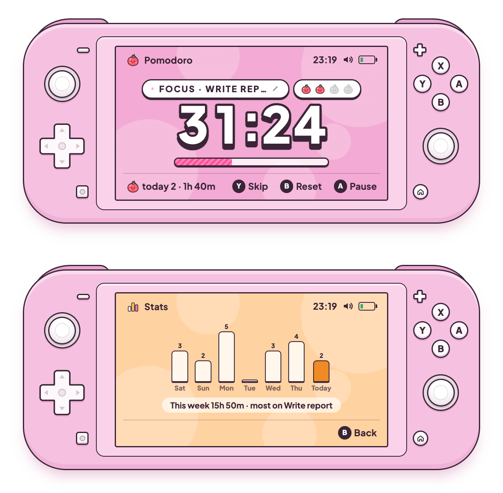
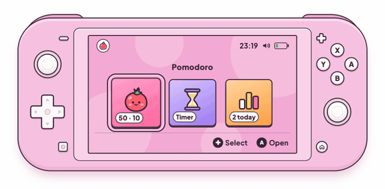

# Pomo Lite

A tiny pomodoro timer styled like a **pink handheld game console**. Pick a **50/10** or **25/5** focus cycle or set your own minutes, get a **long break after every four sessions**, name the task you're on, and see how much you focused this week. Press the buttons or tap the screen like you would on a real handheld. It runs in any modern browser, and it also builds into a small macOS app where only the console floats on your desktop, or shrinks to a tiny pill that stays on top.





## Try it

Open it right in your browser at **[gianneangely.github.io/pomo-lite](https://gianneangely.github.io/pomo-lite/)**, or get your own copy:

```bash
git clone https://github.com/GianneAngely/pomo-lite.git
```

Open `index.html` in a browser. The font, icons, and sounds all live inside that one file, so it works offline.

## Build the macOS app

You need macOS and the Xcode Command Line Tools (`xcode-select --install`).

```bash
cd pomo-lite/mac
./build.sh
```

This puts **Pomo Lite.app** in `/Applications`. Drag the console by its pink body, press `⌘W` to hide it (timers keep running, and the Dock icon brings it back), and press `⌘Q` to quit.

## What's inside

- **Pomodoro** — 50/10 or 25/5 cycles that keep rolling on their own, with a long break after every 4 focus sessions (four little tomatoes show where you are in the set)
- **Settings** — the + button sets your own focus, break, and long-break minutes, how many sessions come before the long break, and whether the next phase starts by itself
- **Task label** — tap the Focus pill (or press `T`) to name what you're working on
- **Stats** — today's sessions and minutes under the timer, and a Stats tile with the last 7 days and the task you spent the most time on
- **Mini mode** — the capture button shrinks the console to a small pill that stays above other windows
- **Countdown** — set hours, minutes, and seconds, or switch to **Until** and count down to a day and time (say, Wednesday at 07:00)
- **Home menu** — pick Pomodoro, Countdown, or Stats from the tiles, like a console home screen
- **Alarms** — a chime, a quick rumble, and a glowing Home button when time is up. The macOS app also bounces its Dock icon.
- **Keeps your place** — reload or reopen, and a running timer picks up where it left off

## Controls

Every button on the console is clickable, and the screen works like a touchscreen: tap the tiles, the button hints, the timer itself to start or pause, the countdown arrows, the app name to go home, or the speaker to mute.

| Button | Key | Action |
| --- | --- | --- |
| A | `Space` | Start or pause |
| B | `R` | Reset (press twice to clear finished sessions) |
| Y | `S` | Skip to the next phase |
| X | `X` | Switch mode: 50/10 or 25/5, Timer or Until |
| D-pad or sticks | Arrow keys | Pick a tile, set the countdown or the target day and time |
| L / R | `Q` / `E` | Jump between Pomodoro, Countdown, and Stats |
| + | `+` | Settings |
| Capture | `C` | Mini mode on or off |
| Focus pill | `T` | Name your task |
| Home | `H` | Back to the home menu |
| − | `M` | Sound on or off |

## Built with

HTML · CSS · vanilla JavaScript, plus Swift and WKWebView for the macOS app. No libraries and no build step for the web version. In the browser, alarms are scheduled on the Web Audio clock, so they still ring on time from a background tab. The macOS app rings them with native timers, so they keep working while the window is hidden.

The typeface is [Plus Jakarta Sans](https://fonts.google.com/specimen/Plus+Jakarta+Sans) (SIL Open Font License), embedded in the page.
